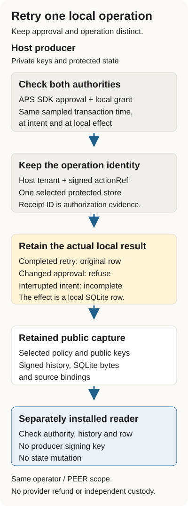

# Approved refund retries: technical reference

Start with the [worked example](../APS-REFUND-RETRIES.md) for the retry story and
the three outcomes. This reference keeps the installation, inspection and refusal
commands together for developers and agents.

An approval receipt can be reissued for the same signed action. Its receipt ID
changes; the action you meant to perform does not. If a host treats each receipt
as a new operation, a retry can record the action twice.

This worked example uses the unchanged APS SDK 7.2.1 to check a synthetic refund
approval. Observer binds the operation to the host tenant and the signed action
reference, then retains its intent and completion in one protected SQLite store.
You will inspect the retained records of an interrupted process and check them with a
separately installed reader. The effect here is a local refund-record row. No
payment provider is called.



## Check the retained example

The operator's runtime ran the crash cases; the packets it wrote are retained under
[`retained/`](../../interop/aps-durable-refund-2026-10-05/retained) in the profile directory. This
page is about reading them. Use Linux, Python 3.12, [uv](https://docs.astral.sh/uv/), and Node
20.20.2 or 22.23.3. The install needs network access for the pinned Python and npm dependencies.
This remains a source-only profile, not a published package release.

From `packages/agent-evidence-observer`:

```sh
cd interop/aps-durable-refund-2026-10-05
npm ci --ignore-scripts
uv venv .venv --python 3.12
uv pip install --python .venv/bin/python --require-hashes -r requirements.lock
uv pip install --python .venv/bin/python --no-deps ../.. .
.venv/bin/python -I -B verify_retained.py
```

`verify_retained.py` runs the installed public reader on every retained capture, with its own
`host-policy.json` hash as the consumer selection, and requires the exit status, stdout and stderr
to equal the bytes retained with the capture. The important files are:

| File | What you can inspect |
| --- | --- |
| `retained/native/native-report.json` | Process attempts, local admissions and effects for each capture |
| `retained/native/approval-reissue/attempts.json` | Completion, refused changed approval and retry of the original approval |
| `retained/native/lost-ack/attempts.json` | An interrupted acknowledgement followed by a retry |
| `retained/native/after-intent/attempts.json` | An interrupted intent followed by refused automatic replay |
| Each case's `service.sqlite` | The captured signed state, event history and actual local row |
| Each case's `host-policy.json` | Public keys, selected source/member hashes and the expected local counts |
| `retained/*-reader.json` | The reader output retained for each case |

The fixed fixture clock tests the declared authorization boundaries. It does not
establish freshness against an outside clock.

## Read the retained result

The reader has its own installed environment and receives public records, not the producer's
signing keys. For this author-controlled example, the policy hash is computed locally from the
retained `host-policy.json`. A deployment consumer must select its policy, keys and hashes through
its own accepted process; hashing an unfamiliar packet does not make it trusted.

The retained reader output for the three cases reports:

```text
approval-reissue 1 1 recorded-local-sqlite-refund-row
lost-ack 1 1 recorded-local-sqlite-refund-row
after-intent 1 0 not-established-after-interruption
```

The columns are the case, its logical admissions, its local effects and its outcome. The
approval-reissue result also says `same-operation-changed-authorization-refused`: a genuine
reissued approval is not accepted as the original store's frozen authorization. Retrying the
original approval returns its retained completion. A separately approved different action has a
different operation identity and its own capture.

For lost acknowledgement, the local row already committed before the process
stopped. The retry returns that result. For the interrupted intent, the record
does not establish a completed effect, and automatic replay refuses. An accepted
reader result for that case confirms the retained incomplete record; it does not
turn the missing effect into a success.

Counts apply to each capture. The original completion and approval-reissue captures
share one operation; do not add their counts as separate workloads.

## Check a real refusal

Give the reader a policy hash that does not match the retained policy. It must exit two with the
policy-selection refusal and leave the SQLite bytes unchanged.

```sh
case_path=retained/native/approval-reissue
before=$(sha256sum "$case_path/service.sqlite" | cut -d' ' -f1)
.venv/bin/python -I -B -m probity_aps_refund.reader "$case_path" \
  --policy-sha256 0000000000000000000000000000000000000000000000000000000000000000 \
  --node "$(command -v node)" --verifier verify-aps.mjs; echo "exit=$?"
test "$(sha256sum "$case_path/service.sqlite" | cut -d' ' -f1)" = "$before" && echo unchanged
```

The reader prints `public host policy differs from consumer selection` and exits two. The
refusal produces no accepted result and does not alter the captured database.
Keep the original policy and all refusal evidence. Do not replace a selected hash
merely to make a consumer accept a changed packet.

## What this establishes

The host checks the genuine SDK decision and its separate local grant at the same
sampled time inside each SQLite transaction. The native profile explicitly selects
UTC milliseconds; finer observations and alternate timestamp spellings refuse.
The public reader checks current authority, retained intent/effect observations,
signed history, selected payload bytes and the actual local row.

This is a controlled process-crash example on one host filesystem. Retaining the
same protected store is part of its boundary. Losing that state or choosing a new
store root does not preserve replay protection. It does not test power loss,
filesystem corruption or distributed failover.

Both installations are operated by the same author. They retain `witnessScope:
PEER` and `independentCustody: false`. Separate processes, wheels and public-key-only
reading do not establish an independent operator, independent custody, delegated
authority, merchant legitimacy, PIC integration or a completed provider refund.

Read the [profile protocol](../../interop/aps-durable-refund-2026-10-05/PROTOCOL.md)
for the exact source, authority and storage contract, and the
[Node 20/22 qualification workflow](../../../../.github/workflows/package-observer-aps-durable-refund.yml)
for the complete qualification and retained public artifacts.
